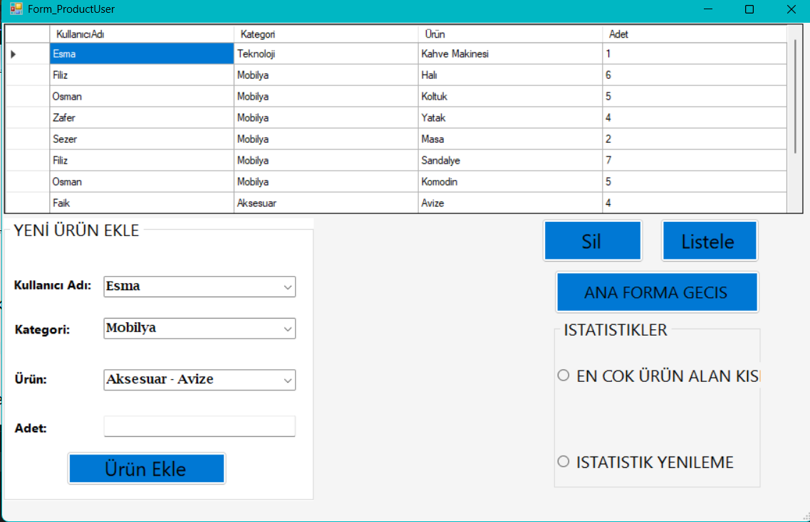
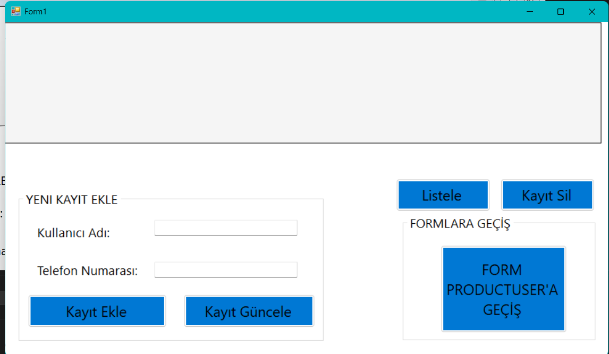

# 📦 Kurumsal Stok ve Kullanıcı Takip Otomasyonu

C# ve Windows Forms teknolojileri kullanılarak geliştirilmiş, ilişkisel veritabanı altyapısıyla çalışan masaüstü tabanlı bir stok ve demirbaş yönetim sistemidir. Bu proje, kurumsal varlıkların ve kullanıcı hareketlerinin takibini optimize etmek amacıyla tasarlanmıştır.

---

## 🚀 Proje Hakkında
Günlük operasyonel süreçlerde ürünlerin, kategorilerin ve kullanıcı zimmet/takip işlemlerinin tek bir panel üzerinden yönetilmesini sağlar. Katmanlı bir mantıkla tasarlanan projede, kullanıcıların verileri anlık olarak listeleyebileceği, güncelleyebileceği ve istatistiksel verilere (en çok ürün alan kişi vb.) ulaşabileceği modüler formlar yer almaktadır.

---

## 🛠️ Kullanılan Teknolojiler
* **Dil:** C# (.NET Framework / Windows Forms)
* **Veritabanı:** MS SQL Server, T-SQL
* **Veri Yönetimi:** ADO.NET / Dataset Yapısı

---

## 📌 Temel Özellikler
* **Kullanıcı ve Stok Yönetimi:** Yeni kullanıcı ekleme, silme, güncelleme ve listeleme işlemleri.
* **Kategorilendirme & Ürün Takibi:** Ürünlerin kategorilere göre takibi ve stok durumlarının kontrolü.
* **İstatistiksel Veriler:** Hangi kullanıcının en çok ürün aldığını gösteren özet paneller.
* **Modüler Form Geçişleri:** Farklı operasyonel pencereler arasında akış kontrolü.

---

## 🖥️ Projeden Ekran Görüntüleri

| Kullanıcı & Stok Listeleme Paneli | Veri Giriş ve Yönetim Ekranı |
| :---: | :---: |
|  |  |

---

## ⚙️ Kurulum ve Çalıştırma
Projeyi kendi bilgisayarınızda çalıştırmak için şu adımları izleyebilirsiniz:

1. Projeyi bilgisayarınıza klonlayın veya indirin:
   ```bash
   git clone [https://github.com/iremcoban20/Stock-Management-WinForms.git](https://github.com/iremcoban20/Stock-Management-WinForms.git)